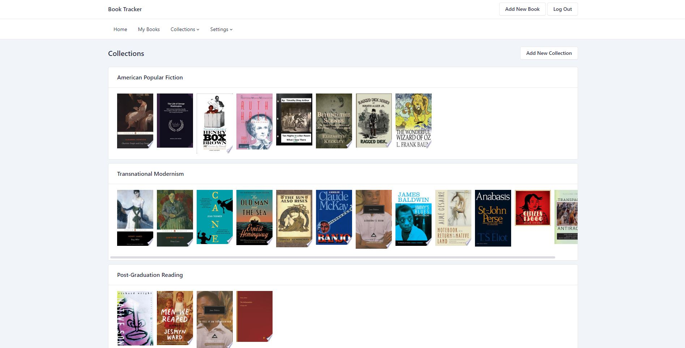
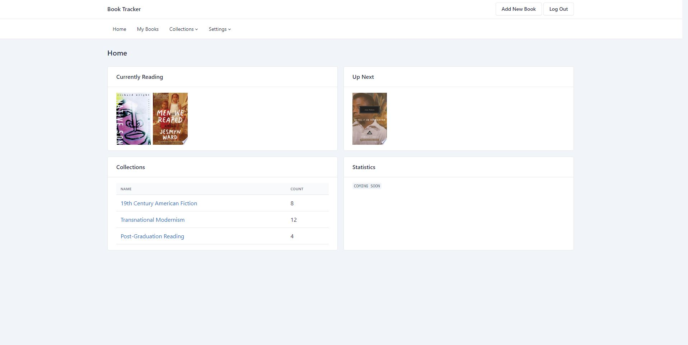
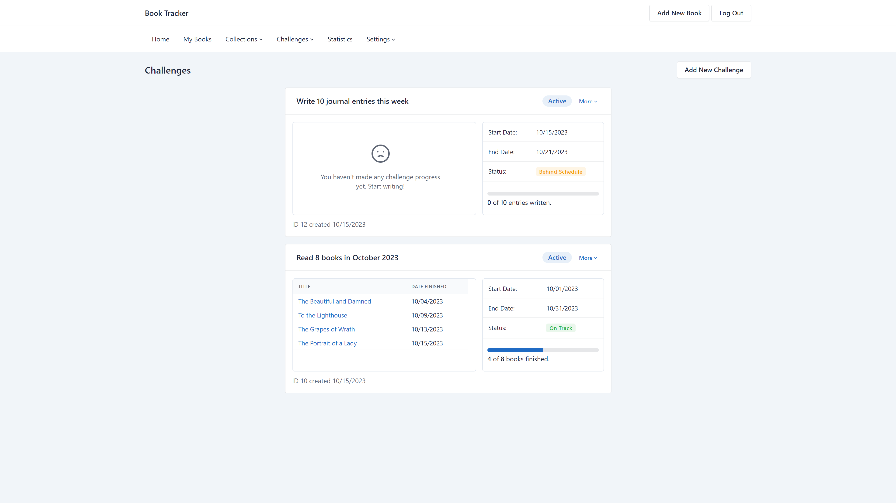
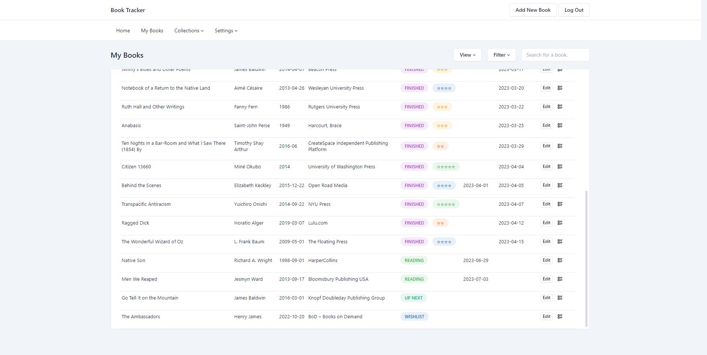
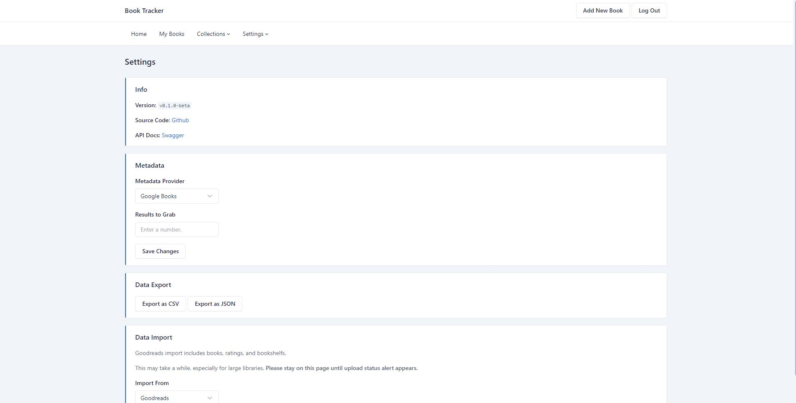
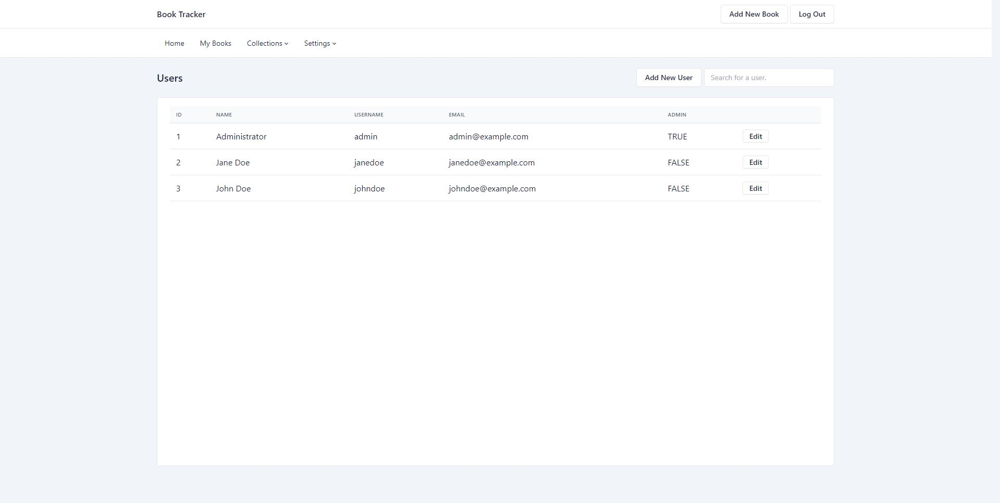

# booktracker
**Booktracker** is an open source application for managing and tracking a personal book library. 

Using metadata grabbed from Google Books, easily add books and organize them into collections. Set each book’s status, give it a rating, and track how long it took to read. 

This fork's primary repository is [DaHokeyPokey/booktracker](https://github.com/DaHokeyPokey/booktracker). Open pull requests against its [`main` branch](https://github.com/DaHokeyPokey/booktracker/tree/main); see [CONTRIBUTING.md](CONTRIBUTING.md).

Booktracker is under active development; expect bugs and breaking changes.

Licensed under [MIT](LICENSE), with the original Copyright (c) 2023 wars2k notice retained.



## Features

- Add books with metadata provided by the Google Books API.
- Add books manually without using an external metadata provider.
- Organize books into collections.
- Create customer reading/writing challenges and track your progress.
- Write private journal entries about a book.
- View book-related statistics like books read per month, etc. 
- Multi-user support.
- Import book data and bookshelves from Goodreads.
- Export data to JSON or CSV.

## Documentation

- [Development and focused checks](docs/development.md)
- [Deployment contracts, configuration, and backups](docs/deployment.md)
- [Planned releases and publication gates](docs/releases.md)

## Installation

**Original-project Docker Compose example (not this fork's image)**

The example below references the original project's `wars2k/booktracker:latest`, not a verified build of this fork. Its contents and availability have not been verified here.

The intended fork image is `ghcr.io/dahokeypokey/booktracker`, but no fork image has been verified or published by this workflow. That namespace is planned, not a working installation target.

**Source-build warning:** This fork still targets unsupported .NET 7. The current Dockerfile copies `Booktracker/external`; do not build it with real user data. Safe packaging, supported-runtime and publication gates remain unresolved; see the [deployment guide](docs/deployment.md#status-and-prerequisites).

1. Paste this `docker-compose.yml` file into an empty directory, replacing with the correct info where necessary
    
    ```yaml
    version: "3.3"

    services:
        booktracker:
            image: wars2k/booktracker:latest
            restart: unless-stopped
            environment:
                GOOGLE_BOOKS_API_KEY: ${GOOGLE_BOOKS_API_KEY}
            volumes:
                - ./data:/app/external
            ports:
                - 2341:5000 #replace 2341 with your desired port.
    ```

    The Google Books API key is optional. Supply it through the deployment environment before running Docker Compose. Do not place a real key directly in this file or commit it to the repository.

    Supported configuration sources:

    - `GOOGLE_BOOKS_API_KEY` — preferred exact environment variable.
    - `GoogleBooks__ApiKey` — standard ASP.NET environment-variable mapping for `GoogleBooks:ApiKey`.
    - `GoogleBooks:ApiKey` — application configuration key.

    Equivalent application configuration:

    ```json
    {
      "GoogleBooks": {
        "ApiKey": ""
      }
    }
    ```

    `GOOGLE_BOOKS_API_KEY` takes precedence when it is non-empty. If no key is supplied, Booktracker continues using unauthenticated Google Books requests. Rate-limit or provider failures are shown in the Add New Book page, where Manual Entry remains available.
    
2. Create the `data` directory with the following three subdirectories: 
    - `db`
    - `log`
    - `export`

   Before starting the container, make sure that the directory strucutre looks like this: 
    ```
   booktracker/
    ├── docker-compose.yml
    └── data/
        ├── db
        ├── log
        └── export
    ```
    
3. Start the container (from the same directory as your `docker-compose.yml` file): 
    
    ```bash
    docker compose up -d
    ```

## Focused development checks

From the repository root, in an isolated .NET 7 SDK environment with Node.js 18 or newer:

Both .NET projects currently target unsupported .NET 7. These are compatibility checks, not production-release approval. Use a supported Node.js release; the Node minimum describes test compatibility, not lifecycle support.

```bash
dotnet restore Booktracker.Tests/Booktracker.Tests.csproj
dotnet run --project Booktracker.Tests/Booktracker.Tests.csproj --no-restore
node --test Booktracker.Tests/search.test.js
```

The .NET console harness uses fake Google Books responses and a temporary SQLite database that it removes after each endpoint check. It covers provider retries, timeouts, API errors, failed-save writes, and Manual Entry independence. The JavaScript checks run `search.js` with stub fetch/DOM objects, including overlapping requests; they do not replace browser/layout validation. No real Google Books key is needed.

## Screenshots

**Home Page**



**Challenge Page**


**Main Book Page**



**Settings**



**Users**


 
